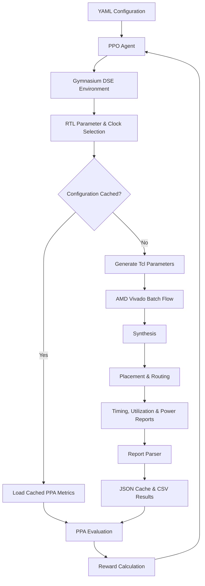

# 🚀 RL-PPA-Optimizer
### Reinforcement Learning-Based Power, Performance & Area Optimization for FPGA Designs

<p align="center">
  <b>Automated Design Space Exploration using PPO and AMD/Xilinx Vivado</b>
</p>

<p align="center">
  
  
  
  
  
</p>

---

## 📌 Overview

**RL-PPA-Optimizer** is an automated, hardware-agnostic Reinforcement Learning (RL) framework for FPGA Design Space Exploration (DSE).

Traditional FPGA optimization often involves manually changing RTL parameters, running synthesis and implementation, and comparing Power, Performance, and Area (PPA) results. This process can be time-consuming, especially when exploring a large number of hardware configurations.

This project addresses that challenge by integrating **Proximal Policy Optimization (PPO)** with AMD/Xilinx Vivado to automate the design optimization process.

An RL agent intelligently explores different Verilog design configurations, evaluates their actual hardware implementation through Vivado, and learns to identify configurations with improved PPA characteristics.

Unlike approaches that rely entirely on simulated hardware metrics, this framework uses **real Vivado synthesis, placement, routing, and post-route reports** to evaluate design configurations.

### 🎯 Key Objectives

- Automate FPGA Design Space Exploration using Reinforcement Learning.
- Optimize Power, Performance, and Area simultaneously.
- Reduce manual RTL parameter tuning.
- Evaluate actual hardware implementation metrics using Vivado.
- Explore timing-constrained design configurations.
- Support different parameterized Verilog designs through YAML configuration files.

---

## ✨ Key Features

- **PPO-Based Optimization:** Uses Stable-Baselines3 PPO to intelligently explore hardware design configurations.
- **Hardware-Agnostic Architecture:** Supports different Verilog designs without modifying the core optimization engine.
- **Real Vivado Integration:** Performs headless synthesis, placement, and routing using AMD/Xilinx Vivado.
- **Multi-Parameter Exploration:** Optimizes RTL parameters and target clock periods together.
- **Timing-Aware Reward Function:** Penalizes configurations with negative Worst Negative Slack (WNS).
- **Persistent Result Caching:** Stores previously evaluated configurations in JSON files to avoid redundant Vivado executions.
- **Automated Report Parsing:** Extracts timing, resource utilization, and power metrics from Vivado reports.
- **Performance Visualization:** Generates CSV results and Pareto-front plots for analyzing optimization trade-offs.
- **Multiple Hardware Benchmarks:** Validated using Sobel Edge Detection and Pipelined FIR Filter designs.

---

## 🏗️ System Architecture

The framework follows a closed-loop Reinforcement Learning and Electronic Design Automation (EDA) workflow.



### 🔄 Working Methodology

**1. Configuration Initialization**

The user defines the target FPGA, Verilog source files, top module, parameter search spaces, clock options, and reward weights through a YAML configuration file.

**2. RL Agent Initialization**

The PPO agent interacts with a custom Gymnasium environment called `HardwareDSEEnv`.

The environment uses a `MultiDiscrete` action space to represent the indices of the selected RTL parameters and clock period.

**3. Design Configuration Generation**

The selected action is converted into actual Verilog parameter values and a target clock period.

A persistent JSON cache is checked before launching Vivado.

**4. Vivado Hardware Evaluation**

For a new configuration, the framework generates a dedicated run directory and a `params.tcl` file.

Python launches Vivado in headless batch mode to perform:

- RTL elaboration and synthesis.
- Logic optimization.
- Placement.
- Routing.
- Timing analysis.
- Resource utilization analysis.
- Power analysis.

**5. PPA Metric Extraction**

The report parser extracts:

- Worst Negative Slack (WNS).
- Critical Path Delay.
- Slice LUT utilization.
- Slice Register (FF) utilization.
- Dynamic Power.

An area score is calculated using:

`Area Score = LUTs + 0.5 × FFs`

**6. Reward Calculation**

The environment calculates a reward based on normalized PPA metrics and timing violations.

The PPO agent uses this feedback to improve its future design configuration selections.

**7. Results and Visualization**

The framework exports explored configurations and their PPA metrics into CSV files, maintains JSON caches, and generates Pareto-front visualizations.

---

## 🧠 Reinforcement Learning Approach

### Algorithm: Proximal Policy Optimization (PPO)

This project uses PPO, a policy-gradient reinforcement learning algorithm, to optimize hardware design parameters.

**Libraries:**
- Stable-Baselines3
- Gymnasium
- NumPy

### Environment Design

| Component | Implementation |
|---|---|
| Environment | `HardwareDSEEnv` |
| RL Algorithm | PPO |
| Action Space | MultiDiscrete |
| State | Current design configuration and evaluation information |
| Reward | Negative normalized PPA cost with timing penalty |
| Evaluation | Vivado post-route reports |

### Reward Function

The reward function considers normalized power, delay, and area metrics.

\[
R = -(C_{PPA} + P_{timing})
\]

Where:

\[
C_{PPA} =
0.40P_{norm} +
0.35D_{norm} +
0.25A_{norm}
\]

The weights are:

| Metric | Reward Weight |
|---|---:|
| Power | 0.40 |
| Delay | 0.35 |
| Area | 0.25 |

The timing penalty is:

\[
P_{timing} =
\begin{cases}
2.5 \times |WNS|, & WNS < 0\\
0, & WNS \geq 0
\end{cases}
\]

Here, the normalized PPA metrics are calculated relative to the middle-parameter baseline configuration.

The objective is to minimize the overall PPA cost while avoiding timing violations.

---

## 🛠️ Technologies & Tools

| Technology | Purpose |
|---|---|
| Python 3.12 | Main programming language |
| Stable-Baselines3 | PPO reinforcement learning algorithm |
| Gymnasium | Custom RL environment |
| AMD/Xilinx Vivado 2025.2.1 | FPGA synthesis and implementation |
| Verilog HDL | Hardware description |
| Tcl | Vivado automation |
| NumPy | Numerical operations |
| Pandas | Experimental data processing |
| Matplotlib | PPA visualization |
| PyYAML | Configuration management |
| JSON | Persistent evaluation caching |
| Windows 11 | Development environment |

### Target FPGA

- **Family:** Artix-7
- **Device:** `xc7a35tcpg236-1`
- **EDA Tool:** AMD/Xilinx Vivado 2025.2.1

---

## 📂 Repository Structure

```text
RL-PPA-Optimizer/
│
├── benchmarks/
│   │
│   ├── mock_hardware/
│   │   └── config.yaml
│   │
│   ├── sobel_accelerator/
│   │   ├── config.yaml
│   │   ├── top.v
│   │   ├── sobel_filter.v
│   │   └── image_loader.v
│   │
│   └── pipelined_fir/
│       ├── config.yaml
│       └── fir_filter.v
│
├── optimizer/
│   ├── dse_env.py
│   ├── run_vivado.tcl
│   ├── report_parser.py
│   ├── train_agent.py
│   └── plot_results.py
│
├── results/
│   ├── cache_sobel_edge_accelerator_vivado.json
│   ├── sobel_edge_accelerator_vivado_results.csv
│   ├── sobel_pareto_plot.png
│   ├── cache_pipelined_fir_filter_vivado.json
│   ├── pipelined_fir_filter_vivado_results.csv
│   └── fir_pareto_plot.png
│
├── input.mem
├── requirements.txt
├── .gitignore
└── README.md
```

### Important Modules

| File | Responsibility |
|---|---|
| `dse_env.py` | Custom Gymnasium environment, action mapping, caching, and Vivado execution |
| `train_agent.py` | PPO initialization, training, evaluation, and CSV export |
| `run_vivado.tcl` | Automated Vivado synthesis and implementation flow |
| `report_parser.py` | Extraction of timing, utilization, and power metrics |
| `plot_results.py` | Pareto-front and Power-versus-Delay visualization |

---

## ⚙️ Installation & Setup

### Prerequisites

Before running the project, install:

1. Windows 11.
2. Python 3.12.
3. AMD/Xilinx Vivado 2025.2.1.
4. A supported FPGA device and installed Vivado device files.

### Step 1: Clone the Repository

```bash
git clone https://github.com/Hanshitha07/RL_PPA_Optimizer.git
```

```bash
cd RL_PPA_Optimizer
```

### Step 2: Create a Python Virtual Environment

```bash
py -3.12 -m venv venv
```

Activate it:

```bash
venv\Scripts\activate
```

### Step 3: Install Dependencies

```bash
python -m pip install --upgrade pip
```

```bash
pip install -r requirements.txt
```

### Step 4: Configure Vivado

Make sure Vivado is installed and the following executable is accessible:

```text
C:\AMDDesignTools\2025.2.1\Vivado\bin\vivado.bat
```

Update the Vivado executable path in the project configuration/code if your installation directory is different.

---

## 🚀 Running the Project

### 1. Run the Mock Hardware Benchmark

The mock benchmark allows testing the RL environment without launching actual Vivado hardware implementation flows.

```bash
python optimizer/train_agent.py --config benchmarks/mock_hardware/config.yaml --steps 100 --mock
```

### 2. Run the Sobel Accelerator Benchmark

```bash
python optimizer/train_agent.py --config benchmarks/sobel_accelerator/config.yaml --steps 60
```

### 3. Run the Pipelined FIR Filter Benchmark

```bash
python optimizer/train_agent.py --config benchmarks/pipelined_fir/config.yaml --steps 20
```

*These commands assume the corresponding CLI options are configured as shown in the project.*

### 4. Generate PPA Visualizations

```bash
python optimizer/plot_results.py
```

The visualization script generates Pareto-front and Power-versus-Delay plots from the experimental results.

---

## 🧪 Experimental Benchmarks

The framework has been evaluated using two different parameterized Verilog hardware designs.

### Benchmark 1: Sobel Edge Detection Accelerator

<image src="results/sobel_pareto_plot.png" alt="Sobel accelerator Pareto plot" />

**Objective:** Explore different Sobel accelerator configurations to optimize PPA metrics.

**Design Space:**

| Parameter | Available Values |
|---|---|
| RAM_STYLE | block, distributed |
| GRAD_WIDTH | 9, 10, 11 |
| APPROX_MODE | 0, 1, 2 |
| PIPE_STAGES | 1, 2, 3 |
| CLK_PERIOD (ns) | 6, 8, 10, 12, 14 |

**Total Search Space:** 90 configurations.

#### Baseline vs RL-Optimized Results

| Metric | Baseline | RL Optimized |
|---|---:|---:|
| Dynamic Power | 23.0 mW | 16.0 mW |
| Critical Path Delay | 8.340 ns | 9.342 ns |
| WNS | +1.660 ns | +4.658 ns |
| Slice LUTs | 167 | 167 |
| Slice Registers | 169 | 169 |
| Area Score | 251.5 | 251.5 |
| Composite PPA Score | 1.0000 | 0.9203 |

#### Optimization Results

<details>
<summary><b>View optimization improvements</b></summary>

| Metric | Improvement |
|---|---:|
| Dynamic Power Reduction | 30.43% |
| Timing Slack Improvement | 2.998 ns |
| Area Overhead | 0% |
| Overall PPA Improvement | 7.97% |

**Baseline Configuration:**

```text
RAM_STYLE = distributed
GRAD_WIDTH = 10
APPROX_MODE = 1
PIPE_STAGES = 2
CLK_PERIOD = 10.0 ns
```

**RL-Optimized Configuration:**

```text
RAM_STYLE = block
GRAD_WIDTH = 11
APPROX_MODE = 2
PIPE_STAGES = 1
CLK_PERIOD = 14.0 ns
```

The RL-selected configuration achieved lower dynamic power and improved timing slack without increasing the reported area score.

</details>

**Key Observation:**

The optimized design operates with a longer target clock period, resulting in a longer critical path delay but greater positive timing slack.

This illustrates an important FPGA design trade-off: a design can achieve lower power while maintaining timing feasibility by relaxing its clock constraint.

### Benchmark 2: Pipelined 4-Tap FIR Filter

<image src="results/fir_pareto_plot.png" alt="FIR filter Pareto plot" />

**Objective:** Validate the framework's ability to optimize a different parameterized hardware architecture without modifying the core optimizer.

**Design Space:**

| Parameter | Available Values |
|---|---|
| DATA_WIDTH | 8, 12, 16 |
| PIPE_EN | 0, 1 |
| APPROX_COEFF | 0, 1 |
| CLK_PERIOD (ns) | 5, 8, 10, 12 |

**Total Search Space:** 48 configurations.

**Validation:**

- Successfully executed end-to-end headless Vivado synthesis and implementation.
- Evaluated a different Verilog architecture.
- Reused the same core optimization engine.
- Generated separate experimental result and cache files.

This demonstrates the framework's plug-and-play architecture across different parameterized RTL designs.

*Detailed numerical baseline-versus-optimized FIR metrics are not included here because they have not been specified.*

---

## 📈 Results & Visualization

The framework generates the following experimental artifacts:

| Output | Description |
|---|---|
| `*_results.csv` | Explored configurations and PPA measurements |
| `cache_*.json` | Cached hardware evaluation results |
| `*_pareto_plot.png` | Pareto-front visualization |
| Power vs Delay plot | Trade-off between dynamic power and critical path delay |

### Why Pareto Optimization?

Power, performance, and area are competing hardware objectives.

A configuration that reduces power may increase delay, while a configuration that improves timing may require additional hardware resources.

Pareto-front analysis helps identify non-dominated configurations that represent different PPA trade-offs.

---

## 🔧 Engineering Challenges & Solutions

During development, several practical integration challenges were addressed.

| Challenge | Solution |
|---|---|
| Python 3.15 package compatibility | Migrated to Python 3.12 to use compatible prebuilt dependency wheels. |
| NumPy JSON serialization | Converted NumPy action values to native Python integers and added JSON serialization support. |
| Windows Vivado argument parsing | Passed only the output directory through `-tclargs` and moved parameter definitions into `params.tcl`. |
| Vivado optimization of unused Sobel logic | Placed `input.mem` in the project root so the image loader could access real initialization data. |
| Vivado timing report parsing | Updated regex parsing to correctly extract negative and positive WNS values from Vivado 2025.2 reports. |
| Repeated hardware evaluations | Implemented persistent JSON caching for previously evaluated configurations. |

These solutions improved the reliability of the closed-loop Python-to-Vivado optimization workflow.

---

## 🔮 Future Enhancements

- **Surrogate Modeling:** Develop a machine learning-based surrogate model to estimate PPA metrics and accelerate exploration.
- **Fast Training Mode:** Introduce a `--fast` mode for large-scale RL training with reduced dependence on expensive Vivado runs.
- **Advanced RL Algorithms:** Experiment with SAC, TD3, and other optimization algorithms where appropriate.
- **Multi-Objective Optimization:** Explore Pareto-aware reward functions and multi-objective RL approaches.
- **Expanded FPGA Support:** Validate the framework on additional FPGA families and devices.
- **Automated RTL Integration:** Improve support for different Verilog architectures and configuration formats.
- **Enhanced Analytics:** Add convergence curves, reward history, and more detailed PPA comparison reports.

---

## 👨‍💻 Author

**Hanshitha Killi**

- GitHub: [@Hanshitha07](https://github.com/Hanshitha07)
- Project Repository: [RL-PPA-Optimizer](https://github.com/Hanshitha07/RL_PPA_Optimizer)

---

## ⭐ Acknowledgements

- [AMD/Xilinx Vivado Design Suite](https://www.amd.com/en/products/software/adaptive-socs-and-fpgas/vivado.html)
- [Stable-Baselines3](https://stable-baselines3.readthedocs.io/)
- [Gymnasium](https://gymnasium.farama.org/)
- [PyTorch](https://pytorch.org/)

---

<p align="center">
  <b>Automating FPGA Design Space Exploration through Reinforcement Learning 🚀</b>
</p>
